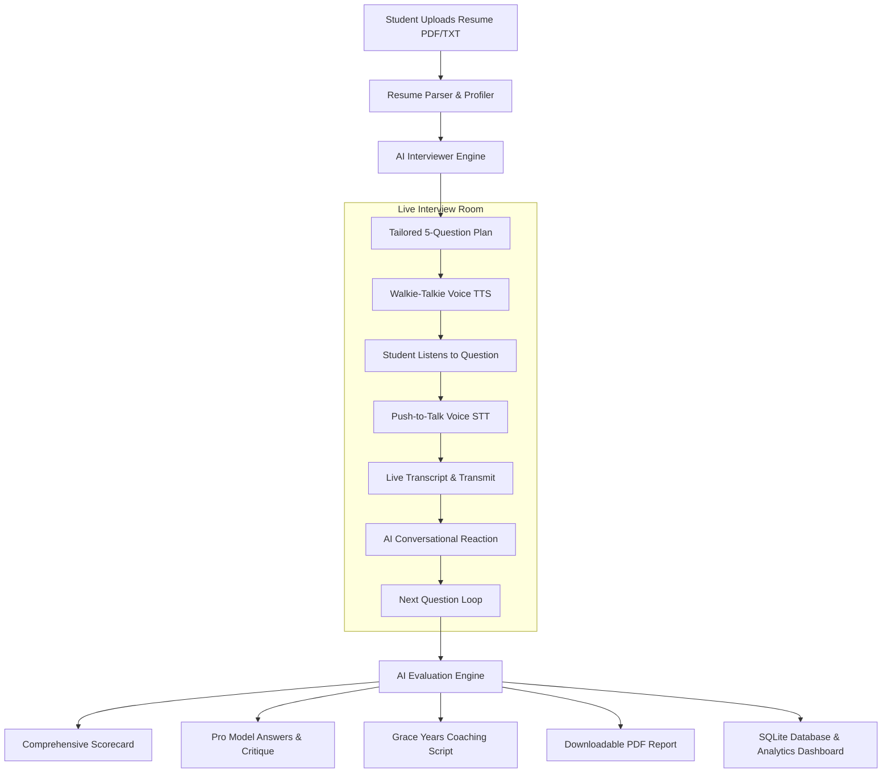

# 🎯 AI Interview Copilot Pro
> **Online Resume-Driven Mock Interview Platform with Conversational Walkie-Talkie Voice Mode & Grace-Years Coaching**

[](https://share.streamlit.io/)
[](https://python.org)
[](LICENSE)
[](https://aistudio.google.com)

---

## 📌 Overview

**AI Interview Copilot Pro** is an end-to-end intelligent interview preparation platform designed specifically for students, fresh graduates, and career changers. 

Unlike standard generic interview chatbots, AI Interview Copilot Pro:
1. **Reads & Understands Your Complete Resume**: Deeply parses your projects, tech stack choices, architectural contributions, and detected skill gaps.
2. **Features Interactive "Walkie-Talkie" Voice Mode**: The AI interviewer speaks questions aloud using Text-to-Speech (TTS), and candidates respond with voice using Push-to-Talk live Speech-to-Text (STT) and radio audio chirps!
3. **Masterclass in Grace / Gap Years**: Detects and coaches students on how to explain graduation delays, career transitions, and gap periods with undeniable confidence and positive framing.
4. **Actionable Post-Interview Evaluation & Pro Model Answers**: Generates a comprehensive scorecard (Technical Depth, Communication, Confidence, Problem Solving, STAR method), provides line-by-line model answers showing how senior engineers answer each question, and produces an **official downloadable PDF report**.

---

## 🚀 Key Features

- **📄 Deep Resume Profiler**: Upload PDF or TXT resumes. Automatically parses candidate name, technologies, project highlights, and detected grace years.
- **📻 Walkie-Talkie Voice Channel**:
  - Browser-native zero-latency Text-to-Speech (TTS) for interviewer audio.
  - Push-to-Talk Speech Recognition (STT) with live transcription.
  - Sound effects (radio chirp on transmission start/stop).
  - Live editable transcript fallback.
- **⏳ Grace Years & Gap Coaching**: Dedicated coaching on framing gap periods as seasons of disciplined upskilling and practical portfolio building, with personalized "Power Statements".
- **💎 Senior Pro Model Answers**: Question-by-question review contrasting the candidate's answer with an exemplary model answer.
- **📊 SQLite Database & Historical Transcripts**: Tracks interview progress, score trajectory, and historical Q&A sessions.
- **📥 Downloadable Official PDF Reports**: Generates professional, multi-page candidate evaluation reports using `reportlab`.
- **⚡ Multi-Model & Offline Simulation**: Powered by Google Gemini (`gemini-2.5-flash`), OpenAI, or Groq—with an **intelligent offline fallback simulator** requiring zero API keys!

---

## 🏗️ System Architecture



---

## 🛠️ Tech Stack

- **Frontend & App Framework**: [Streamlit](https://streamlit.io/)
- **LLM Integrations**: Google Gemini (`google-genai`), OpenAI (`openai`), Groq
- **Audio & Voice Processing**: HTML5 Web Speech API (`SpeechRecognition` & `SpeechSynthesis`) + Web Audio API
- **Document & PDF Parsing**: `PyPDF2`
- **PDF Generation**: `reportlab`
- **Database**: SQLite3
- **Data Analytics**: `pandas`

---

## ⚡ Quick Start

### 1. Clone the Repository
```bash
git clone https://github.com/NakulBidhuri/Ai_interview_copilot.git
cd Ai_interview_copilot
```

### 2. Set Up Virtual Environment & Dependencies
```bash
python -m venv .venv
# On Windows:
.\.venv\Scripts\activate
# On Linux/macOS:
source .venv/bin/activate

pip install -r requirements.txt
```

### 3. (Optional) Configure API Key
Create a `.env` file in the root folder:
```env
GEMINI_API_KEY="your-gemini-api-key-here"
```
*(Note: You can also enter your key directly in the UI under **Settings**, or run in **Offline Simulation Mode** with zero keys!)*

### 4. Run the Streamlit Application
```bash
streamlit run app.py
```
Open your browser at `http://localhost:8501`.

---

## 🌐 Deploy to Streamlit Community Cloud

1. Push this repository to your GitHub account: `https://github.com/<your-username>/Ai_interview_copilot`
2. Go to [share.streamlit.io](https://share.streamlit.io/) and log in with your GitHub account.
3. Click **"New app"**, select:
   - **Repository**: `<your-username>/Ai_interview_copilot`
   - **Branch**: `main`
   - **Main file path**: `app.py`
4. In **Advanced Settings -> Secrets**, add:
   ```toml
   GEMINI_API_KEY = "your-api-key"
   ```
5. Click **Deploy!** 🚀

---

## 📄 License
This project is open-source under the MIT License.
